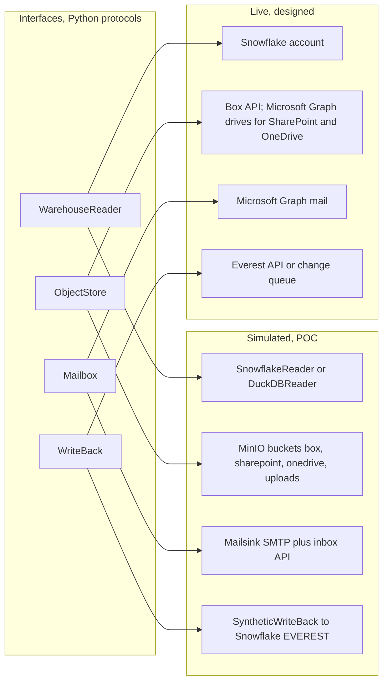
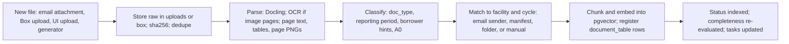

# Ingestion and Integration Specification

How data gets into ABIQ Marks, how documents and emails are processed, how ABIQ writes back, and how the simulated connectors map to the real ones later.

---

## 1. Connector architecture

Every external system is behind an interface with two implementations: `Simulated` (built in the POC) and `Live` (designed, stubbed, not built). The services above the interface never know which one is active.

| Interface | Methods | Simulated by | Live by |
| --- | --- | --- | --- |
| `WarehouseReader` | `query(sql, params)`, `fetch_table(schema, table, since)`, `health()` | Snowflake connector against the synthetic database, or DuckDB over parquet | Snowflake connector with key-pair auth |
| `ObjectStore` | `put(store, path, bytes, metadata)`, `get(store, path)`, `list(store, prefix, since)`, `exists`, `sha256` | MinIO, one bucket per store | Box SDK for `box`; Microsoft Graph drive items for `sharepoint` and `onedrive` |
| `Mailbox` | `send(template_code, to, cc, merge_fields, attachments)`, `send_raw(eml)`, `poll_inbox(since)`, `get_message(id)`, `get_attachment(id, name)` | Mailsink: SMTP sink plus REST inbox that the generator and tests can post into | Microsoft Graph `/me/messages` and `/sendMail` on a shared mailbox |
| `WriteBack` | `write_spread(spread)`, `write_cmr(cmr)`, `write_pricing_panel(row)`, `write_pricing_status(row)`, `write_governance_signoff(record)`, `write_risk_rating(row)`, `status(change_id)` | Writes rows into the Snowflake `EVEREST` schema | Everest API if one exists; otherwise a change queue a person applies (section 6) |

Configuration selects the implementation per interface in `config/connectors.yaml`. Health checks for every connector appear on S22.

## 2. Snowflake ingestion

### 2.1 What is read and when

| Dataset | Query | When | Lands in |
| --- | --- | --- | --- |
| Loan universe | Transorg Data Spec.md section 2.6 | At cycle creation (Q1), on demand ("refresh universe"), and nightly | `cycle_loan` (snapshot at kickoff; later refreshes only add late additions and update funded amounts, never change previous marks) |
| Previous period marks and ratings | `EVEREST.PRICING_PANEL`, `EVEREST.RISK_RATING` for the previous period | At cycle creation | `cycle_loan.previous_*`, `marks_tracker_row.previous_*` |
| Prior spreads | `EVEREST.SPREAD_MODEL`, `SPREAD_VALUE` for the last four quarters | When a spread run starts (Q4) | `financial_spread` prior-quarter rows for LTM |
| Prior CMRs | `EVEREST.CMR`, `CMR_SECTION` for the previous period | When a CMR is created (Q5) | Indexed into `cmr:<facility_id>` |
| Everest state for reconciliation | `PRICING_PANEL`, `RISK_RATING` for the current period | On each reconciliation run (Q19) | `reconciliation_item.value_b` |
| Sentry positions | `SENTRY.POSITION` as of day 0 and month end | Kickoff, reconciliation, monthly M1 and M4 | `cycle_loan.funded_amount`, `ddtl_rebalance` |
| Monthly inputs | `SIGMA.PORTFOLIO_SNAPSHOT`, `FINANCE.PACING_FILE`, `FINANCE.WATCHLIST_CALL_NOTE` | Monthly M1 | `monthly_update_row` |

Reads are idempotent and keyed by `(source, as_of)`. A read is recorded in `ingestion_run` (source, started, finished, rows, status, error) so S22 shows the last successful sync per source.

### 2.2 DuckDB fallback

If `source.*.location = duckdb`, the same SQL runs against DuckDB attached to the generator's parquet files. The dialect differences (`TIMESTAMP_NTZ`, `NUMBER`) are handled in DDL only; queries use ANSI SQL. This lets a developer run the whole stack without a Snowflake account.

## 3. Document pipeline

| Stage | Detail | Failure handling |
| --- | --- | --- |
| Store | Raw bytes saved under `uploads/inbox/<message-id>/` or the Box path; `sha256` computed; a file with the same hash for the same facility and period is linked, not re-parsed | Storage error: retry 3 times, then `status = failed` with the error on S04 |
| Parse | Docling converts PDF, DOCX, XLSX to a document model with pages, text blocks and tables; XLSX sheets become tables directly; image-only pages go through OCR (Tesseract in the POC; configurable); page PNGs rendered with PyMuPDF at 110 dpi for evidence links | Parse error: `failed`, the file is still viewable; the analyst can spread manually |
| Classify | A0 Document Classifier (Agentic AI Spec - Transorg Deck.md section 6.1): cheap model, structured output `{doc_type, confidence, reporting_period, borrower_name_mentions, has_covenant_calc, has_sponsor_commitment, has_waiver_request}`; below `classify.confidence_threshold` (0.8) the document goes to the "confirm classification" queue | Model error: queue for manual classification |
| Match | Order: Box manifest (Lincoln files), email sender domain against `DEALCLOUD.BORROWER.EMAIL_DOMAIN`, subject line facility or borrower name, classifier borrower mentions; otherwise manual in S04 | Ambiguous: manual |
| Index | Chunks (Transorg Data Spec.md section 6) with metadata `{facility_id, period, doc_type, page}`; tables registered whole in `document_table` | Embedding error: retry; document usable without retrieval |

Tables are the key output for spreading. `document_table` keeps the header row, the body rows as arrays of cell strings, and the page bounding box, so the Spreading Agent can cite `{doc_id, page, table_index, row, col}` and the UI can highlight the cell on the page image.

Size limits (POC): 50 MB per file, 300 pages per document; larger files are rejected with a message.

## 4. Email pipeline

### 4.1 Inbound

| Step | Detail |
| --- | --- |
| Poll | The worker polls `Mailbox.poll_inbox(since)` every 60 seconds (configurable); in the demo, the generator posts emails into the inbox API in day order |
| Dedupe | By `message_id` |
| Thread | `thread_id` from the `In-Reply-To` and `References` headers; replies to a ABIQ-sent email inherit its `cycle_id` and `facility_id` |
| Match | Sender domain against borrower domains; Lincoln's domain routes to the Lincoln exchange; deal team and committee addresses route to their cycles; else `unmatched` queue in S04 |
| Attachments | Each attachment enters the document pipeline with `email_message_id` |
| Intent (optional) | A0 also tags inbound mail with `{intent: package_submission, question, waiver_request, approval_reply, other}` so that an approval reply from the chair ("Approved") can be linked to the approval request automatically, subject to the chair confirming in S15 |

### 4.2 Outbound

- Every outbound email is built from an `email_template` with merge fields, rendered to text and HTML, previewed in the UI, and sent through `Mailbox.send`. The stored `email_message` row has `direction = out`, the template code, the cycle and facility links, and the attachment document ids.
- Attachments are referenced by document id; the mailbox implementation fetches bytes from the object store.
- Nothing is auto-sent: reminders and chases drafted by A8 wait for a person, and kickoff, pack, approval request and distribution emails are sent by a person pressing Send. The only system-sent mail is the optional notification digest, which carries no business content.

### 4.3 Threads in the UI

S04 (intake), S05 (Lincoln exchange) and S15 (approvals) show the email thread per loan or per cycle with direction, sender, time, attachments and the link to the entity it produced.

## 5. Notifications

| Event | In-app | Email |
| --- | --- | --- |
| Task assigned or due in 3 days or overdue | yes | optional digest (daily, configurable) |
| CMR sent back, review requested, review passed | yes | yes to the owner |
| Lincoln files received, send-back shared | yes | yes to the PM Team and the deal team |
| G1 decision, committee decision, approval, sign-off | yes | yes to the PM Team |
| Reconciliation mismatch found | yes | no |
| Agent run finished (spread ready, draft ready) | yes | no |

Notifications are rows in `notification` (user_id, kind, entity, read_at) delivered to the UI over server-sent events.

## 6. Write-back adapter

ABIQ is the system of record for workflow, decisions and the tracker, but the client's record for spreads, CMRs, the pricing panel, ratings and governance sign-off is Everest. The adapter has three modes:

| Mode | Behaviour | When |
| --- | --- | --- |
| `synthetic_write` | Writes directly into the synthetic `EVEREST` schema in Snowflake (or DuckDB) with `SOURCE_SYSTEM = 'tiq'` and the ABIQ entity id | POC default |
| `queue` | Creates a `writeback_change` row (target table, key, payload, requested_by, status `pending`) and shows it in S22 "Changes to apply in Everest" with a copyable payload; a person marks it `applied` after doing it in Everest; reconciliation (Q19) then confirms | Production default until an API exists |
| `api` | Calls the Everest API (interface stubbed; mapping to be defined when AllianceBernstein answers DQ20) | Future |

Rules:
- Every write is recorded in `writeback_change` in all modes, with before and after values, so the audit trail shows what ABIQ changed in the client system and when.
- Writes are only triggered by user actions that pass a gate or an approval (spread approved, CMR filed, G1 decided, committee decided, reconciliation correction, G3 signed). Agents never trigger a write.
- Writes are idempotent: the payload carries the ABIQ entity id and version; re-sending the same version is a no-op.

## 7. Box, SharePoint and OneDrive behaviour

| Store | Inbound | Outbound |
| --- | --- | --- |
| Box (`box`) | Watcher lists `<period>/lincoln-out/` every 60 seconds; new files enter the document pipeline with `source = box_watch`; a marks XLSX triggers A4 extraction; a PDF report is linked to the facility named in it | Packages (Q3) and send-back notes (Q14) are written with a manifest; Lincoln's portal view (S05) reads the same paths |
| SharePoint (`sharepoint`) | none | CMR PDFs (Q8, Q15), Lincoln report copies (Q13), committee pack (Q17); paths from Transorg Data Spec.md section 3.1; a write records the `document` row with `store = sharepoint` |
| OneDrive (`onedrive`) | none | Approval evidence bundles (Q20, M6) and the final marks schedule |

File names are deterministic (`<borrower-slug>-<facility-id>-v<n>.pdf`) so a human browsing the real SharePoint later finds the same structure.

## 8. Jobs, scheduling and reliability

| Concern | Design |
| --- | --- |
| Worker | One `worker` process with a job queue in Postgres (`job` table: kind, payload, status, attempts, run_after, locked_by); kinds: `ingest_email`, `ingest_document`, `parse`, `classify`, `index`, `agent_run`, `reminder_scan`, `box_watch`, `snowflake_sync`, `render_pdf`, `send_email`, `export_xlsx` |
| Idempotency | Every job has a natural key (for example `parse:<sha256>`); duplicates are skipped |
| Retries | 3 attempts with backoff 10s, 60s, 300s; after that `failed` with the error visible on S22 and, where relevant, on the loan |
| Long runs | Agent runs stream progress events (`agent_run.progress`) to the UI; the analyst can open the loan while the spread is running |
| Scheduling | `reminder_scan` every hour, `box_watch` and `ingest_email` every 60 seconds, `snowflake_sync` nightly at 02:00, all configurable |
| Clock | The demo has a "cycle clock" (S01) that can be moved forward to a day so that deadlines, overdue flags and the generator's playback agree; production uses the real date |
| Ordering | Agent runs for the same loan are serialised; different loans run in parallel with a global semaphore (default 4) because each run makes many model calls |

## 9. Security and data handling

- Secrets (Snowflake key, model API keys, MinIO credentials) in environment variables or Docker secrets; never in the repo.
- Roles enforced in the API (Transorg Deck Visualization Master Spec.md section 7); object store paths are never exposed directly, downloads go through signed, short-lived URLs issued per user and logged.
- Model calls: documents are sent as extracted text and tables, never as raw files unless the OCR step needs the page image; prompts and tool results are logged for tracing with the ability to redact fields marked sensitive (none in the synthetic set, but the hook exists).
- No client data in the POC. The generator's names are fictional; the three example loans are from the process notes.
- Deletion is not available in the UI; an admin reset of the demo drops the whole database.

## 10. Mapping to the live systems (for the phase after the POC)

| Simulated | Live equivalent | Notes |
| --- | --- | --- |
| Snowflake synthetic database | Client Snowflake, schemas for DealCloud, Everest and Sentry as they really are | Confirm table and column names (DQ4, DQ20); the loan universe query is the only place that changes |
| MinIO `box` | Box API with a service account on the shared Lincoln folder; webhooks instead of polling | Lincoln keeps working in Box; nothing changes for them |
| MinIO `sharepoint`, `onedrive` | Microsoft Graph drive items on the PrivateCredit site and the PM OneDrive | Same folder conventions |
| Mailsink | Microsoft Graph on a shared mailbox (for example `valuations@`) with send-as rights | Borrowers keep emailing; ABIQ reads the shared inbox |
| Synthetic write-back | `queue` mode first; `api` mode when Everest access is confirmed | The Q19 reconciliation is the safety net in queue mode |
| Local users | Entra ID single sign-on with role mapping | Roles unchanged |
