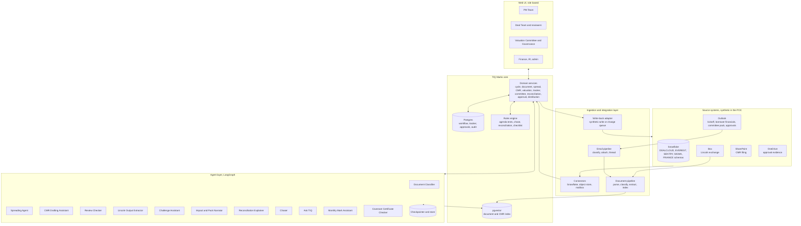

# TIQ Marks POC: Master Specification

**Product:** TransorgIQ Private Credit, Marks Module (working name "TIQ Marks")
**Client context:** AllianceBernstein Private Credit, monthly and quarterly marks (valuation approval) process
**Document set version:** 1.0, 8 October 2026
**Audience:** the TransOrg build team. This is the entry document; read it first, then the numbered documents it points to.

---

## 0. Document map

| File | Document | What it covers | Read it when |
| --- | --- | --- | --- |
| Transorg Deck Visualization Master Spec.md | **Master Spec** (this file) | Goal, scope, principles, architecture, roles, glossary, open items | First |
| Transorg Functional Spec.md | [Process and Functional Spec](Transorg%20Functional%20Spec.md) | Every step of the monthly (6) and quarterly (22) process: input, owner, action, data, system, output, next owner, exception, what the POC does at that step, where AI assists | Building any workflow feature |
| Transorg Data Spec.md | [Data Spec](Transorg%20Data%20Spec.md) | Every entity, where it is stored (Snowflake, document stores, app database), schemas, the synthetic dataset and the worked example numbers | Building the data layer or the synthetic data generator |
| Ingestion Integration Spec - Transorg.md | [Ingestion and Integration Spec](Ingestion%20Integration%20Spec%20-%20Transorg.md) | Connectors, document and email pipelines, sync cadence, write-back policy | Building connectors or pipelines |
| Agentic AI Spec - Transorg Deck.md | [Agentic AI Spec](Agentic%20AI%20Spec%20-%20Transorg%20Deck.md) | As-is process without agents, agency map, architecture decision, HLD and LLD per agent, LangGraph layout, HITL, evaluation | Building any agent or LLM feature |
| Transorg UI UX Spec.md | [UI/UX Screens Spec](Transorg%20UI%20UX%20Spec.md) | Shell, navigation, every screen per role, utilities on each screen, components and states | Building the front end |
| Build Plan Transorg Deck.md | [Build Plan](Build%20Plan%20Transorg%20Deck.md) | Phases, milestones, environments, testing, demo script, definition of done | Planning sprints |
| XLSX | `TIQ Marks POC Feature Roadmap.xlsx` | Every feature in build order, with section, sub-section, status chip, dependencies and the spec reference | Tracking progress |

Conventions used across all documents:

- Quarterly steps are **Q1 to Q22**, monthly steps are **M1 to M6**. Approval gates are **G1** (Deal Team), **G2** (Valuation Committee), **G3** (Governance Panel). Rework loops are **QA to QE** (quarterly) and **MA to MC** (monthly).
- Screens are **S01 to S22**. Agents and LLM components are **A0 to A11** (three of them, A1, A5 and A9, are agents in the strict sense; the rest are single model calls or chains). Discovery questionnaire questions are **DQ1 to DQ20**, so they are never confused with process steps. Features in the roadmap are **F-xxx**.
- "Mark" means the price of a loan per 100 of face value. A mark of 88.0 on a $60M loan values it at $52.8M.
- "Source note" means the six process walkthrough notes and the AllianceBernstein process map that this spec is built from. Numbers in the worked example come from those notes.
- No em dashes anywhere, including generated UI text and emails.

---

## 1. Why this POC exists

AllianceBernstein Private Credit has to give every private loan a fair value ("mark") each quarter, and a lighter update each month. Private loans have no market price, so the value is built by people: borrowers send financials, the Deal Team analyses them and writes a report (the CMR), an independent firm (Lincoln) prices each loan, the Deal Team challenges or accepts that price, a Valuation Committee decides the difficult cases, every copy of the number is reconciled, and a Governance Panel signs off. The quarterly cycle has 22 steps, six phases, three approval gates and at least five rework loops, and it has to finish within 45 days of quarter end.

Today the process runs across seven tools (DealCloud, Outlook, Box, Everest, SharePoint, an Excel marks tracker, OneDrive) with Sentry and Snowflake behind them. Nobody has one view of where every loan is. The expensive work is manual: spreading borrower financials into the standard model, drafting the CMR commentary, re-keying Lincoln's numbers, building the committee pack, and reconciling four copies of the same mark.

The POC proves that one governed workflow can run this process end to end, with AI agents doing the preparation and people making every decision, without replacing the client's systems of record.

## 2. Goal and success criteria

### 2.1 Goal

Build a working system, on synthetic data, that runs one full quarterly cycle (Q3 2026) and one monthly cycle for a portfolio of roughly 24 loans, covering all 22 quarterly steps and all 6 monthly steps, with every approval gate, every rework loop, and a complete audit trail from source document to final mark.

### 2.2 What "done" looks like for the POC demo

The demo follows the three loans from the source notes (Maple Dental, Harbor Logistics, Sunrise Foods) through the whole cycle and ends on a final approved portfolio value of **$114.625M**, down **$3.175M** from **$117.8M**, with:

1. Harbor spread by the Spreading Agent from a borrower PDF, reviewed and approved by the analyst, showing leverage **3.75x** against a **3.50x** covenant.
2. Harbor's CMR drafted with AI assistance, reviewed by the A/C Manager, PM Team and SCT, with the review comments from the source notes resolved (equity letter attached, truck appraisal date added, customer concentration sentence added).
3. Lincoln's draft marks ingested from a report and a spreadsheet (Maple 99.25, Harbor 86.5, Sunrise 89.0) and the early impact summary (**-$3.95M**) produced for the finance leads.
4. Harbor sent back at Gate 1 with an evidence-backed challenge (the $5M sponsor equity), Lincoln's revised 88.0 ingested, and the revised impact (**-$3.05M**) produced.
5. The agenda tests run by the rules engine (the client's four plus TIQ's `g1_unresolved`): Maple off the agenda, Harbor and Sunrise on it.
6. Committee decisions captured: Harbor 88.0, Sunrise reduced from 89.0 to **88.5** with the rationale.
7. Reconciliation catching the Sunrise mismatch (Everest 89.0 vs committee 88.5) and the correction recorded.
8. Written approval (Gate 2) and governance sign-off (Gate 3) recorded with evidence, final CMRs distributed to Finance, Investor Relations and the Deal Teams.
9. Any mark traceable in one click to its documents, spread, CMR versions, Lincoln versions, decisions and approvers.

### 2.3 Measures

| Measure | Target for the POC | How it is measured |
| --- | --- | --- |
| Step coverage | 22 of 22 quarterly steps, 6 of 6 monthly steps runnable in the UI | Demo script walkthrough (Build Plan Transorg Deck.md) |
| Spreading accuracy | 95 percent of template line items mapped correctly on the synthetic packages, measured against the generator's ground truth | Eval set in Agentic AI Spec - Transorg Deck.md section 16 |
| Spreading time | Analyst review of an AI spread under 10 minutes per package in the demo | Timed demo run |
| CMR draft usefulness | Analyst keeps at least 60 percent of AI drafted sentences unchanged on the three demo loans | Edit distance logged by the CMR editor |
| Challenge quality | The Harbor challenge note cites the sponsor equity letter and the net leverage recalculation (55 / 16 = 3.4x) without being told to | Eval case |
| Agenda tests | 100 percent agreement with the hand-computed results on all loans | Unit tests on the rules engine |
| Reconciliation | Every seeded mismatch found, zero false positives | Unit tests |
| Audit | Every gate decision has who, what, when, evidence | Audit screen |
| Cost | Under $2 of model spend per loan per cycle on the synthetic set | Cost meter in the admin screen |
| Agent autonomy | Zero decisions made by an agent; every write to a mark, rating, watchlist or approval is by a person | Code review and audit log |

## 3. Scope

### 3.1 In scope

- Both cycles: the 22-step quarterly process and the 6-step monthly process, including DDTL rebalancing.
- All three approval gates and all eight rework loops.
- A loan universe read from DealCloud and Everest data in Snowflake, Sentry funded amounts in Snowflake (assumed, see open items), and documents from simulated Box, SharePoint, OneDrive and Outlook.
- Synthetic data generator for every source, including borrower financial packages in varied formats, Lincoln reports, and emails.
- Agentic AI assistance where it earns its place: spreading, CMR drafting, review pre-checks, Lincoln output extraction, the Gate 1 challenge, impact and pack narratives, reconciliation explanations, chasing, and an Ask TIQ assistant over the cycle.
- Role-based web UI for the PM Team, Deal Teams, reviewers (A/C Manager, SCT), the Valuation Committee, the Governance Panel, Finance and IR recipients, and an admin.
- Rules engine with every threshold configurable and flagged as confirmed or assumed.
- Full audit trail and mark lineage.
- Evaluation harness for the agents.

### 3.2 Out of scope for the POC

- Live connections to AllianceBernstein's production systems. Every connector has a real-API design and a simulated implementation; only the simulated one is built in the POC. The Snowflake connector is real but points at a synthetic database.
- Lincoln's own valuation model. Lincoln stays an external party; the POC ingests what Lincoln returns and offers a cross-check, it does not replace Lincoln.
- NAV calculation, investor reporting, accounting entries (Finance and IR only receive the outputs).
- Single sign-on and enterprise identity (the POC uses local users with roles).
- Mobile UI.

### 3.3 Assumptions carried from the client discovery questionnaire

The discovery questionnaire has 20 open questions. Until AllianceBernstein answers them, the POC uses the values in the source notes and marks them as **assumed** in the rules configuration (Transorg Data Spec.md section 8 and Build Plan Transorg Deck.md section 7). The most important ones:

| Assumption | Value used | Discovery question |
| --- | --- | --- |
| Agenda test thresholds | Watchlist, rating downgrade, mark move of 10 percent or more either way, mark outside Lincoln range; any one is enough | DQ17 |
| Cycle length and sample calendar | 45 days; phase day ranges from the process map | DQ1 |
| Loan hierarchy | Borrower to facility to position; mark, rating, CMR and Lincoln value sit at facility level | DQ2 |
| Reviewer order | Deal Team, A/C Manager, PM Team, SCT | DQ10, DQ11 |
| Reconciliation sources | Marks tracker, Everest pricing panel, CMR risk rating, Sentry funded amounts | DQ19 |
| Lincoln exchange format | Package of financials via Box; back comes a PDF report plus a spreadsheet of marks with point, range and required yield | DQ14 |
| Where DealCloud and Everest data live | Snowflake (confirmed by the user) | DQ4, DQ20 |
| Where Sentry data lives | Snowflake (assumed) | DQ4, DQ20 |
| Deal Team may approve at a mark different from Lincoln's point | Allowed with a rationale, so agenda test 4 can fire | DQ15, DQ18 |

## 4. Design principles

1. **Agents prepare, people decide.** No agent sets a mark, a rating, a watchlist flag, an approval or a send-back. Agents produce suggestions with evidence and confidence; a named person accepts, edits or rejects, and the audit log records which.
2. **Process first.** The system mirrors the client's 22 and 6 steps exactly. We change how a step is done (faster, with help, in one place), not what the step is or who owns it. The TIQ step numbering equals the client's step numbering.
3. **Systems of record stay where they are.** DealCloud, Everest and Sentry remain the record for their data. TIQ holds workflow state, the marks tracker, approvals, decisions and the audit trail. Writes to a client system go through a write-back adapter that, in the POC, writes to the synthetic schema, and in production would either call the client API or queue a change for a person to apply (Ingestion Integration Spec - Transorg.md section 6).
4. **Confirmed vs assumed.** Every business rule lives in configuration with a `confirmed_by_client` flag. Assumed rules show an "assumed" chip in the UI. Nothing from the discovery questionnaire is hard-coded.
5. **Evidence over narrative.** Every AI suggestion links to the document page, table cell or prior record it came from. A suggestion with no evidence is shown as such.
6. **Traceability.** A final mark can be traced back through every version and decision in one screen (S21).
7. **Least agency that works.** Deterministic steps stay code. One LLM call is preferred to a chain; a chain to an agent. Agents are used only where the number and order of steps depend on what is found (spreading, challenge analysis, Ask TIQ). See Agentic AI Spec - Transorg Deck.md section 3.
8. **Synthetic only.** No client data enters the POC. The generator produces everything, including the worked example.

## 5. System overview

### 5.1 Architecture in one picture



### 5.2 Technology choices

| Layer | Choice | Why |
| --- | --- | --- |
| Backend | Python 3.12, FastAPI, SQLAlchemy, Pydantic v2 | Same language as the agent layer; typed contracts shared between services and agents |
| Workflow and agents | LangGraph 1.x and LangChain 1.x, `init_chat_model` for provider-agnostic models | Required by the design method (Agentic AI Spec - Transorg Deck.md); checkpointer gives pause and resume for human gates |
| App database | PostgreSQL 16 with pgvector | One database for workflow state, LangGraph checkpoints and store, and vector retrieval; fewer moving parts |
| Source data | Snowflake (synthetic account or a local schema) | The client's consumption layer; the POC reads DealCloud, Everest and Sentry data from it |
| Document stores | MinIO (S3 API) with one bucket per simulated store: `box`, `sharepoint`, `onedrive` | Same code path as a real object store; swap to Box and Graph APIs later |
| Mailbox | Simulated mail service (SMTP sink plus an inbox API) in the POC; Microsoft Graph adapter designed, not built | Lets the demo send and receive real-looking emails without a tenant |
| Document parsing | Docling (primary) with LlamaParse as an optional backend; PyMuPDF for page images; openpyxl for Excel | Table extraction quality on financial statements; page-level evidence links |
| Models | One strong model for spreading, challenge and CMR drafting; one cheaper model for classification, extraction and summaries; configured by name, swappable | Agentic AI Spec - Transorg Deck.md section 10 |
| Front end | React 18, TypeScript, Vite, Tailwind with the TranspoRG design tokens, TanStack Query and Table, Recharts | Transorg UI UX Spec.md section 1 |
| Observability | LangSmith or Langfuse tracing, structured JSON logs, cost meter per run | Agentic AI Spec - Transorg Deck.md section 11 |
| Packaging | Docker Compose: api, worker, web, postgres, minio, mailsink; Snowflake is external | One command to run the demo |

### 5.3 Deployment shape for the POC

```
docker compose up
  web        React app on :5173
  api        FastAPI on :8000 (REST plus server-sent events for progress)
  worker     background jobs: ingestion, agent runs, reminders, exports
  postgres   app DB, pgvector, LangGraph checkpointer and store
  minio      buckets: box, sharepoint, onedrive, uploads
  mailsink   SMTP sink and inbox API for the simulated Outlook
  snowflake  external account (or the local DuckDB fallback described in Transorg Data Spec.md section 2.4)
```

## 6. Process at a glance

The quarterly cycle, with where TIQ helps. Full detail per step is in document 01.

| Phase | Days (sample calendar) | Steps | Owner | TIQ does | AI assists |
| --- | --- | --- | --- | --- | --- |
| 1 Kickoff and intake | 1 to 9 | Q1 to Q3 | PM Team, Borrower | Builds the cycle from the DealCloud loan list, generates and sends the kickoff email, receives and classifies borrower documents, tracks completeness, shares the package with Lincoln through Box | Document classification, completeness checks, chase drafting |
| 2 Modelling and CMR | 10 to 26 | Q4 to Q9 | Deal Team, A/C Manager, PM Team, SCT | Spreads financials into the standard model, computes metrics and covenant tests, hosts the CMR editor, routes reviews in order, files the CMR PDF to SharePoint | **Spreading Agent**, CMR Drafting Assistant, Review Checker |
| 3 Lincoln draft marks | 18 to 30 (assumed: Lincoln's own work is Days 18 to 20 in the notes and runs alongside Phase 2; the sample calendar starts Phase 3 on Day 26 and TIQ interpolates Q10 to Q13 processing onto Days 26 to 30) | Q10 to Q13 | Lincoln, PM Team | Receives Lincoln's report and marks from Box, extracts them into the tracker, computes value impact, drafts the early impact note, copies the report to SharePoint | Lincoln Output Extractor, Impact Narrator |
| 4 Deal Team approval | 27 to 31 | Q14 to Q15 | Deal Team, Lincoln | Pricing panel with approve or send back (G1), challenge note with evidence, revised valuation ingestion, mark attached to the CMR | **Challenge Assistant**, valuation cross-check |
| 5 Valuation Committee | 36 to 43 | Q16 to Q18 | PM Team, Valuation Committee | Runs the agenda tests, builds and sends the committee pack, captures decisions and rationale (G2 decision) | Pack Narrator, Ask TIQ during the meeting |
| 6 Finalise and distribute | 44 to 45 | Q19 to Q22 | PM Team, Committee, Governance Panel | Reconciles tracker, Everest, CMR and Sentry; requests and records written approval (G2); records governance sign-off (G3); distributes final CMRs | Reconciliation Explainer |

The monthly cycle (M1 to M6) runs the same way at a smaller scale: build the update file from the pacing file, Sigma and watchlist calls, email the deal teams, collect proposed marks with commentary, rebalance DDTL positions, aggregate, and send to the Valuation Committee for approval.

## 7. Roles and permissions

| Role | Who at the client | What they do in TIQ | Cannot |
| --- | --- | --- | --- |
| **PM Team** | Portfolio management analysts, the process owners | Run the cycle: kickoff, intake, Lincoln exchange, tracker, agenda, pack, reconciliation, approval requests, distribution | Approve a mark at G1, decide at G2, sign at G3 |
| **Deal Team Analyst** | Analyst on a deal team (for example Team Blue for Harbor) | Spread, write the CMR, respond to review comments, challenge or approve Lincoln's mark (G1) | Edit another team's loans; change a committee decision |
| **Deal Team Lead** | Lead of the deal team | Co-decides G1 (optional, configurable), owns the team's loans | Same as analyst |
| **A/C Manager** | Account manager for the loan (DealCloud `AC_MANAGER_USER_EMAIL`) | First review of the CMR (Q6) | Edit the CMR directly (comments only) |
| **SCT Reviewer** | Senior credit team | Senior review of the filed CMR | Edit the CMR directly (comments only) |
| **Lincoln** | External valuation firm | Sees only its exchange folder: packages in, reports and marks out, send-back notes | Any internal screen |
| **Valuation Committee Member** | Senior investment staff | Read the pack, record decisions and rationale (G2 decision) | Edit CMRs or spreads |
| **Committee Chair** | Chair of the committee | Everything a member can, plus the written approval of the final marks schedule (G2 approval) | |
| **Governance Panel** | Governance function | Governance sign-off (G3) | Change any mark |
| **Finance / IR (recipient)** | Finance (NAV), Investor Relations, named finance leads (Wes and Justin in the source notes) | Read the impact summaries, final marks and final CMRs | Anything else |
| **Admin** | TransOrg during the POC | Rules configuration, connectors, synthetic data loader, users, agent settings, evaluation | Business actions |

Permissions are enforced in the API per cycle, per loan and per action. Every action that changes a mark, rating, watchlist, approval or decision requires a role with that right and is written to the audit log with the user, timestamp, before and after values, and the evidence attached.

## 8. The worked example (the demo portfolio)

The three loans from the source notes are the backbone of the demo. The generator produces them with exactly these numbers (Transorg Data Spec.md section 7).

| Loan | Facility | Deal Team | Old mark (Q2) | Lincoln draft | Lincoln range | Deal Team G1 | Committee | Final mark | Old value | Final value |
| --- | ---: | --- | ---: | ---: | ---: | --- | ---: | ---: | ---: | ---: |
| Maple Dental | $40M | Team Red | 99.0 | 99.25 | 98.75 to 99.75 | Approve | Not on agenda | **99.25** | $39.60M | $39.70M |
| Harbor Logistics | $60M | Team Blue | 97.0 | 86.5, revised 88.0 | 85.0 to 88.0, revised 86.5 to 89.5 | Send back, then approve 88.0 | Approve 88.0 | **88.0** | $58.20M | $52.80M |
| Sunrise Foods | $25M | Team Green | 80.0 | 89.0 | 87.5 to 90.5 | Approve | Reduce to 88.5 | **88.5** | $20.00M | $22.125M |
| **Total** | **$125M** | | | | | | | | **$117.80M** | **$114.625M** |

Harbor's story carries the analytical detail: revenue $48M to $41M, operating profit before depreciation $7.2M to $4.1M, a $0.3M severance add-back giving adjusted quarterly EBITDA of $4.4M, LTM adjusted EBITDA $16M, debt $60M, leverage 3.75x against a 3.50x covenant (breached), yearly interest $6.2M giving interest cover of about 2.6x, the largest customer (22 percent of revenue) lost, 180 trucks with roughly $38M of collateral, 40 driver positions cut, sponsor Northgate Capital committing $5M of new equity (received 30 October), Lincoln's required yield 16.5 percent then 15.5 percent, and net leverage after the equity of 55 / 16 = 3.4x, back inside the covenant.

The generator adds 21 more in-scope facilities (24 in all, from 22 borrowers) so that the screens look like a real portfolio, with a mix of stable loans, one more watchlist loan, two DDTL facilities for the monthly rebalance, and a handful of borrowers that send late or incomplete packages so that the chase logic has something to do. Team Red is the generator's name for Maple's team; the source notes do not name it.

## 9. Glossary

| Term | Meaning |
| --- | --- |
| Mark | Price of a loan per 100 of face value; 88.0 means 88 percent of the amount lent |
| CMR | The quarterly written report per loan: model, metrics, commentary, risks, recommendation |
| Spreading | Converting a borrower's own financial format into the standard model template |
| LTM | Last twelve months, the period used for ratios to smooth seasonality |
| EBITDA, adjusted EBITDA | Operating profit before interest, tax, depreciation and amortisation; adjusted after agreed add-backs such as one-off costs |
| Leverage | Debt divided by LTM adjusted EBITDA |
| Interest cover | LTM EBITDA divided by yearly interest |
| Covenant | A rule in the loan agreement, for example leverage below 3.50x |
| Waiver | Permission to temporarily ignore a breached covenant |
| Watchlist | Loans with warning signs that get closer attention |
| Risk rating | Internal 1 to 5 scale; 5 is the riskiest in the source notes |
| Required yield | The return a buyer would demand for this loan today; higher yield means lower price |
| Point estimate and range | Lincoln's best single price and the band it considers reasonable |
| Marks tracker | The scoreboard of old mark, draft mark, approved mark, value impact per loan (an Excel file today, a TIQ screen in the POC) |
| Unrealised loss or gain | Change in value of loans still held |
| Pricing panel | The Everest screen where the Deal Team approves or sends back a Lincoln mark |
| Agenda tests | The four client rules (watchlist, downgrade, 10 percent move, outside Lincoln range) plus one TIQ rule (unresolved G1 loop) that decide which loans the Valuation Committee discusses |
| Committee pack | The documents sent to the committee: CMRs, Lincoln reports, proposed marks, tracker |
| Reconciliation | Checking that the tracker, Everest, CMR and Sentry hold the same final numbers |
| Governance sign-off | The formal record in Everest of what was approved, by whom and when |
| DDTL | Delayed-draw term loan; funded and unfunded amounts must be rebalanced monthly |
| Pacing file, Sigma dashboard | Inputs to the monthly update file: a finance pacing file and the Sigma BI dashboard on Snowflake |
| Agent | A model that calls tools in a loop until a task is complete; in TIQ an agent only ever proposes |
| Gate | A point where a named person must act before the cycle continues |

## 10. Open items (to resolve with the client or by decision)

| # | Item | Impact if unresolved | POC handling |
| --- | --- | --- | --- |
| 1 | Where Sentry funded amounts live (Snowflake assumed) | Reconciliation source | Sentry schema in synthetic Snowflake |
| 2 | Everest API or export format for write-back of marks, ratings and governance sign-off | Whether TIQ can write or must queue | Write-back adapter in queue mode by default (Ingestion Integration Spec - Transorg.md section 6) |
| 3 | Lincoln's exact output schema | Extractor accuracy | Extractor is schema-tolerant; fields in Transorg Data Spec.md section 3.3 are assumed |
| 4 | Pacing file format for the monthly cycle | Monthly update file builder | Assumed Excel layout in Transorg Data Spec.md section 3.6 |
| 5 | Add-back policy (which adjustments are allowed) | Spreading Agent flags | Configurable allow-list, every add-back flagged for review |
| 6 | Committee outcome set (approve, change, send back, defer, request information) | Decision capture form | All five supported, "defer" and "request information" assumed |
| 7 | Whether the Deal Team or the PM Team owns steps Q11 and Q13 | Lane assignment | PM Team, per the process map |
| 8 | Monthly vs quarterly differences in agenda rules | Monthly committee step | Same rules, separately configurable |
| 9 | Whether the Deal Team can approve at a mark other than Lincoln's point, and whether the committee can send a loan back to the Deal Team or Lincoln | G1 outcomes, loop QF | Both allowed, flagged assumed (DQ15, DQ18) |

## 11. Risks

| Risk | Mitigation |
| --- | --- |
| Spreading accuracy on real borrower formats is lower than on synthetic ones | Generator produces three format families with noise (scanned pages, merged cells, footnotes); analyst review is mandatory; confidence shown per cell |
| The POC is read as "AI decides marks" | Principle 1 enforced in code; every screen shows who decided; the pitch deck says "agents prepare, people decide" |
| Scope creep into Lincoln's model | Cross-check is a transparent yield-to-price calculator, labelled "indicative", never shown as a mark |
| Client systems differ from the synthetic schemas | Connector interfaces are abstract; schemas in Transorg Data Spec.md are versioned and flagged assumed |
| Model cost on long documents | Document pipeline extracts tables once and caches; agents see page excerpts, not whole PDFs (Agentic AI Spec - Transorg Deck.md section 7) |
